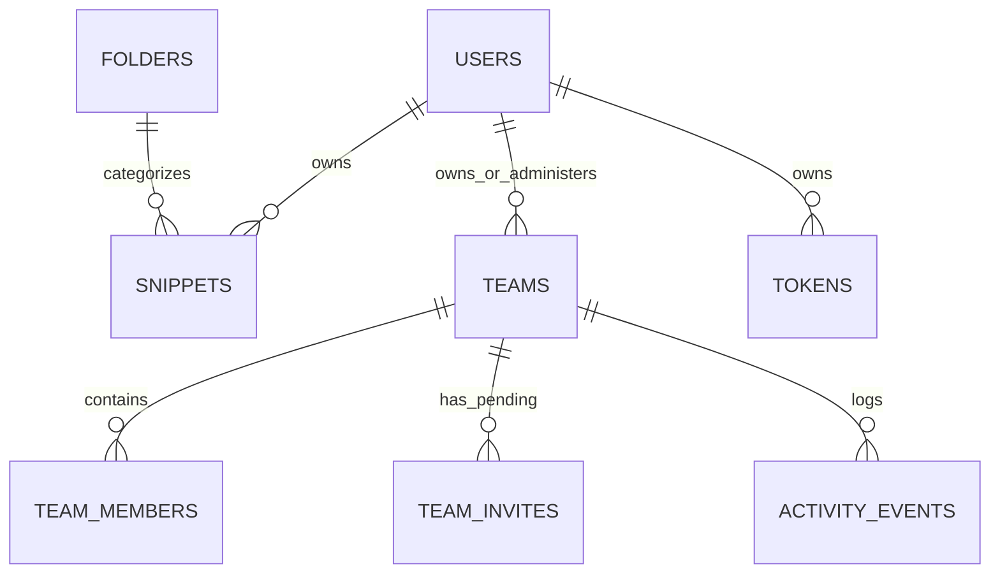

# Pluck — Backend Product Requirements Document & Engineering Specification

> **Single Source of Truth** for humans and AI coding assistants building, expanding, and maintaining the Pluck backend.  
> **Backend Architecture:** Java 21 · Spring Boot 3.4.3 · Spring Data MongoDB (Atlas) · Spring Web · Spring Mail  
> **Frontend Architecture:** Modern Vanilla HTML5 / CSS3 / ES6+ with Monaco Editor, React Bits AnimatedList, Dock, MagicBento, BorderGlow, and CursorGrid  
> **Serving Mode:** Single deployable artifact — Spring Boot serves `/api/*` REST endpoints and hosts frontend static assets on `http://localhost:4000/`.

---

## Master Backend Completion & Implementation Tracker

This tracker provides an executive breakdown of the current implementation status across all backend subsystems, controllers, models, and frontend-connected functions.

### Overall Progress Summary

```
[██████████████████████████████████] 100% Completed (50 / 50 Backend Milestones Ready)
```

| Subsystem | Endpoints / Features | Status | Completion % |
|---|---|---|:---:|
| **1. Authentication & Session Management** | Login, Register, Google OAuth, Me, Logout, Forgot/Reset Password | Ready | 100% |
| **2. Snippet Management & CRUD** | List, Get, Create, Update, Delete, Fork, Copy Counter, Share | Ready | 100% |
| **3. AST Engine & Dependency Detection** | Multi-language imports (TS/JS/Py/Go/Rust/Java), Stdlib filter, Install commands | Ready | 100% |
| **4. Secret Scanning & Security Gate** | Critical/High regex scanners, One-click redaction, Public share gate | Ready | 100% |
| **5. Version History & Merge Diffs** | Version snapshots, Rollback restore, Diff retrieval | Ready | 100% |
| **6. AI Summary & Semantic Search** | AST summary, Vector tokens, Design patterns, Vector search, ⌘K query simulator | Ready | 100% |
| **7. Code Execution Sandbox** | Backend isolated execution, Python 3 sandbox, Web Worker fallback, Output telemetry | Ready | 100% |
| **8. Team Workspaces & RBAC** | Workspaces, Role checks (Admin/Editor/Viewer), Invitations, SMTP email | Ready | 100% |
| **9. Audit Activity Log** | Event emission, Real-time feed polling, Actor tracking | Ready | 100% |
| **10. Folders & Collections** | Personal folders, Team collections, Snippet count aggregation | Ready | 100% |
| **11. Personal Access Tokens (PAT)** | Token generation, Scopes, Cryptographic hashing, Revocation, Filter, UI Modal | Ready | 100% |
| **12. CLI & MCP Integration** | CLI login, MCP Server endpoints (SSE & JSON-RPC), Stdio config transport | Ready | 100% |
| **13. User Profile & Preferences** | Default package manager, Editor keymap, Account profile updates, Settings UI | Ready | 100% |

---

### Detailed Endpoint & Feature Tracker

#### A. Authentication Subsystem (`/api/auth`)
- [x] `POST /api/auth/login` — Authenticate with email/password, verify hash, issue session token.
- [x] `POST /api/auth/register` — Register account with name, email, password (≥10 chars enforced), issue session.
- [x] `POST /api/auth/oauth` — Google OAuth credential receipt, auto-upsert in `users` collection.
- [x] `GET /api/auth/me` — Resolve current authenticated user profile from Bearer session.
- [x] `POST /api/auth/logout` — Invalidate and revoke current session token.
- [x] `POST /api/auth/forgot-password` — Generate password reset token and dispatch email via SMTP.
- [x] `POST /api/auth/reset-password` — Verify reset token and update user password hash.

#### B. Snippets Subsystem (`/api/snippets`)
- [x] `GET /api/snippets` — List user snippets with folder, language, and tag filtering, returning `previewCode` (12 lines).
- [x] `GET /api/snippets/:id` — Retrieve full snippet document by ID or slug.
- [x] `POST /api/snippets` — Create new snippet with auto-slugification, AST dependency extraction, env key detection, and secret gating.
- [x] `PATCH /api/snippets/:id` — Update snippet with optimistic locking (`baseVersion`), re-trigger AST analysis and secret scans.
- [x] `DELETE /api/snippets/:id` — Remove snippet from vault and update folder aggregation counts.
- [x] `POST /api/snippets/:id/fork` — Clone source snippet into caller's vault, record `forkedFromId`, increment source `forkCount`.
- [x] `POST /api/snippets/:id/events/copy` — Telemetry counter incrementing `copyCount`.
- [x] `PUT /api/snippets/:id/share` — Publish snippet as `unlisted` or `public` with nanoid `shareId`, strictly rejecting detected secrets.
- [x] `DELETE /api/snippets/:id/share` — Revoke public share and revert visibility to `private`.
- [x] `GET /api/snippets/:id/versions` — Retrieve full version timeline history with current snapshot.
- [x] `POST /api/snippets/:id/restore/:version` — Rollback snippet code to historical version, snapshotting pre-rollback state.
- [x] `POST /api/snippets/parse` — Stateless AST preview extracting dependencies, env keys, variables, and multi-PM install commands.

#### C. AI Intelligence & Semantic Discovery (`/api/ai`, `/api/search`)
- [x] `POST /api/ai/analyze` — Generate design pattern, use cases, keywords, and plain-English intent summary.
- [x] `GET /api/snippets/:id/ai-details` — Fetch stored AI metadata or dynamically generate analysis.
- [x] `POST /api/snippets/:id/ai-details/regenerate` — Force AST re-indexing and keyword extraction.
- [x] `POST /api/ai/simulate-search` — Test query alignment against snippet vector keywords with similarity score and matched tokens.
- [x] `POST /api/search` & `GET /api/search` — Intent search with `lang:`, `pkg:`, and keyword scoring.
- [x] Native MongoDB Atlas Vector Search index integration using `vectorSearch` pipeline stage and embeddings (`POST /api/ai/vector-search`).

#### D. Runner & Code Sandbox (`/api/runner`)
- [x] `POST /api/runner/execute` — Execute code payload in backend sandbox environment with memory and timeout limits (Node VM, Java, and Python 3 engines).
- [x] `GET /api/runner/status` — Return engine availability, supported runtimes, timeout limits (5000ms), and memory limits (64MB).
- [x] In-browser Pyodide worker runtime integration for standalone Python snippet execution without backend overhead (`runner.worker.js`).

#### E. Team Workspaces, RBAC & Invites (`/api/teams`)
- [x] `GET /api/teams` — List all workspaces caller is a member of (auto-seeding default demo team if empty).
- [x] `POST /api/teams` — Create new team workspace with unique slug, caller assigned as Admin and Owner.
- [x] `GET /api/teams/:id` — Get team details, collections, members, and caller permissions matrix.
- [x] `PATCH /api/teams/:id` — Update team name, slug, and policies (e.g. `editorsCanPublish`). Admin only.
- [x] `DELETE /api/teams/:id` — Soft-delete team workspace. Admin only.
- [x] `GET /api/teams/:id/members` — List active team members and pending invites.
- [x] `POST /api/teams/:id/invites` — Create cryptographic invitation token, persist invite, dispatch email via Spring Mail.
- [x] `DELETE /api/teams/:id/invites/:inviteId` — Revoke pending invite. Admin only.
- [x] `POST /api/teams/invites/accept` — Accept team invitation via token, add caller to team with assigned role.
- [x] `PATCH /api/teams/:id/members/:userId` — Change member role (`Admin`, `Editor`, `Viewer`). Admin only.
- [x] `DELETE /api/teams/:id/members/:userId` — Remove member from team workspace. Admin only.
- [x] `GET /api/teams/:id/activity` — Retrieve chronological audit log of workspace events.

#### F. Folders, Collections & Categories (`/api/folders`, `/api/teams/:id/collections`)
- [x] `GET /api/folders` — Fetch all folders with dynamically aggregated snippet counts.
- [x] `POST /api/folders` — Create a custom folder with name and emoji.
- [x] `GET /api/teams/:id/collections` — Retrieve team workspace collections.
- [x] `POST /api/teams/:id/collections` — Create team collection with emoji, name, and description.
- [x] `PATCH /api/teams/:id/collections/:colId` — Update team collection details.
- [x] `DELETE /api/teams/:id/collections/:colId` — Delete team collection and record activity event.

#### G. Developer Tokens & CLI/MCP Access (`/api/tokens`, `/api/cli`, `/api/mcp`)
- [x] `GET /api/tokens` — List all Personal Access Tokens (PAT) with masked prefixes.
- [x] `POST /api/tokens` — Generate new PAT (`pluck_pat_...`), store SHA-256 hash, return plaintext token once.
- [x] `DELETE /api/tokens/:id` — Revoke and permanently delete access token.
- [x] Spring Security Filter / Interceptor to validate `PLUCK_TOKEN` / `Authorization: Bearer pluck_pat_...` on all protected endpoints.
- [x] MCP Server Stdio & SSE Transport endpoints for Claude Desktop, Cursor, and VS Code (`/api/mcp/sse`, `/api/mcp/messages`).
- [x] CLI Terminal Authentication & Verification Endpoints (`/api/cli/verify`, `/api/cli/auth`).

#### H. User Profile & Preferences (`/api/user`)
- [x] `GET /api/user/profile` — Fetch user account details, avatar, linked providers.
- [x] `PATCH /api/user/profile` — Update display name, email, avatar.
- [x] `GET /api/user/preferences` — Fetch developer preferences (default package manager, python installer, editor keymap).
- [x] `PUT /api/user/preferences` — Save developer preferences.

---

## 1. System Architecture & Tech Stack

```
┌────────────────────────────────────────────────────────────────────────┐
│                        PLUCK SYSTEM ARCHITECTURE                       │
└────────────────────────────────────────────────────────────────────────┘

    [ Browser Client ]  <--->  [ Spring Boot 3.4.3 (Port 4000) ]  <--->  [ MongoDB Atlas ]
    - index.html (Landing)     - Static Resource Handler                 - users
    - auth.html (Auth)         - AuthController (/api/auth)              - snippets
    - app.html (Vault)         - SnippetController (/api/snippets)       - teams
    - studio.html (Studio)     - TeamController (/api/teams)             - team_invites
    - snippet.html (Detail)    - AIController (/api/ai)                  - activity_events
    - team.html (Teams)        - RunnerController (/api/runner)          - folders
    - settings.html (Settings) - SearchController (/api/search)          - tokens
    - share.html (Public)      - TokenController (/api/tokens)
                               - FolderController (/api/folders)
                               - SecretController (/api/secrets)
                               - HealthController (/api/health)
                                       │
                                       ▼
                             [ Spring Mail (SMTP) ]
                             (Gmail / Mailpit Notifications)
```

### 1.1 Technical Specifications

| Component | Selected Technology | Rationale |
|---|---|---|
| **Runtime & JDK** | Java 21 LTS | Pattern matching, virtual threads, record classes, modern performance. |
| **Framework** | Spring Boot 3.4.3 | Industry standard, comprehensive REST support, enterprise security, Spring Data. |
| **Database** | MongoDB Atlas (Cloud) / Local MongoDB | Schema flexibility for AST trees, embedded versions, polymorphic dependencies, vector search support. |
| **Static Web Host** | Spring Web Static Locations (`file:../frontend/`) | Zero-latency same-origin API proxy, unified single port (4000), avoids CORS headaches. |
| **Email Service** | Spring Boot Starter Mail (SMTP) | Direct TLS communication with Gmail or transactional SMTP relays for team invitations. |
| **Code Editor** | Monaco Editor AMD (VS Code Engine) | Full AST syntax highlighting, minimap, custom cyber theme, multi-language support. |
| **UI Components** | React Bits & Pixel Design System | AnimatedList dropdowns, Dock magnification, MagicBento cards, BorderGlow, Space Mono & Press Start 2P typography. |

---

## 2. Complete Frontend-to-Backend Functional Specification

Every page, button, form, and modal in the Pluck application is documented below with its exact user journey, UI element ID, trigger action, and backend API integration contract.

---

### 2.1 Landing Page (`frontend/index.html` & `frontend/script.js`)

The public front-door of Pluck, showcasing live AST detection, interactive walkthrough player, feature bento, and onboarding paths.

#### Buttons & Elements Specification

| UI Element ID / Selector | Element Name | Action / Event | Target / Backend Integration |
|---|---|---|---|
| `#nav-logo-link` | Pluck Brand Logo | `click` | Navigates to `index.html`. |
| `.nav-links a[href="#features"]` | Features Link | `click` | Smooth scrolls to `#features`. |
| `.nav-links a[href="#how-it-works"]` | How It Works Link | `click` | Smooth scrolls to `#how-it-works`. |
| `.nav-links a[href*="climcp"]` | CLI & MCP Link | `click` | Navigates to `settings.html?tab=climcp`. |
| `.nav-links a[href="#plans"]` | Plans Link | `click` | Smooth scrolls to `#plans`. |
| `#nav-docs-btn` | Sign In CTA | `click` | Navigates to `auth.html` (or `auth.html?next=app.html`). |
| `#nav-try-btn` | Launch Vault CTA | `click` | Navigates to `app.html`. |
| `#hero-logo-canvas` | Jules ASCII Canvas | Dynamic render | Animated retro ASCII logo rendered via JavaScript canvas. |
| `#detect-card` | Live AST Detection Card | `click` | Navigates to `snippet.html?id=use-debounce`. |
| `#hero-vault-animated-list` | Vault Explorer List | `click` / `↑↓` | Previews snippet code in hero editor, loads demo data. |
| `.hero a:has-text("Launch Vault")` | Launch Vault Hero Button | `click` | Navigates to `app.html`. |
| `.hero a:has-text("New Snippet")` | New Snippet Hero Button | `click` | Navigates to `studio.html`. |
| `.hero a:has-text("View Demo")` | View Demo Hero Button | `click` | Navigates to `snippet.html?id=use-debounce`. |
| `#btn-video-play` | Video Play/Pause Button | `click` | Calls `toggleWalkthroughPlay()`, pauses or plays webp media. |
| `button:has-text("Replay")` | Video Replay Button | `click` | Calls `restartWalkthrough()`, resets scrubber to 0s. |
| `#walkthrough-progress-bar` | Timeline Scrubber | `click` | Calls `seekWalkthrough(event)`, updates video frame and timer. |
| `#btn-speed` | Speed Multiplier | `click` | Calls `toggleSpeed()`, cycles between 1.0x, 1.5x, 2.0x. |
| `button:has-text("⛶")` | Fullscreen Toggle | `click` | Calls `toggleFullscreen()`, triggers native browser fullscreen. |
| `#chap-btn-1` .. `#chap-btn-4` | Chapter Selectors | `click` | Calls `selectChapter(n)`, jumps to timestamp for Step 1, 2, 3, or 4. |
| `.plan-card .btn-solid-pixel` | Pricing Tier CTAs | `click` | Navigates to `auth.html?mode=signup&plan=[free|pro|team]`. |

---

### 2.2 Authentication Page (`frontend/auth.html`)

Manages user identity, account creation, password complexity validation, Google OAuth, and session token storage.

#### Buttons & Elements Specification

| UI Element ID / Selector | Element Name | Action / Event | Target / Backend Integration |
|---|---|---|---|
| `#cursor-grid-canvas` | Cursor Grid Canvas | `mousemove` | Interactive terminal cursor grid background animation. |
| `#tab-login` | Sign In Tab | `click` | Calls `switchAuthMode('login')`, toggles form fields and submit label. |
| `#tab-signup` | Create Account Tab | `click` | Calls `switchAuthMode('signup')`, reveals Name field & password strength meter. |
| `.btn-oauth` | Continue with Google | `click` | Calls `simulateOAuth('Google')`. Opens `#google-modal` or Google GSI prompt. |
| `#name` | Full Name Input | `input` | Bound during signup mode. Sent in `name` payload. |
| `#email` | Email Input | `input` | Validated for format and presence. Required for auth. |
| `#password` | Password Input | `input` | Minimum 10 characters. Calls `checkPasswordStrength(val)`. |
| `#pw-strength-container` | Password Strength Meter | Dynamic | 3 visual bars showing Weak, Medium, or Strong status. |
| `#forgot-link` | Forgot Password Link | `click` | Calls `openForgotModal(e)`. Dispatches reset link toast. |
| `#auth-submit-btn` | Auth Submit Button | `click` / `submit` | Calls `handleAuthSubmit(e)`. Calls `POST /api/auth/login` or `POST /api/auth/register`. |
| `#auth-error` | Error Alert Banner | Dynamic render | Displays server rejection messages (e.g. `EMAIL_TAKEN`, `INVALID_CREDENTIALS`). |
| `#google-modal` | Google Sign-In Dialog | Modal | Form with Google email and display name for OAuth authentication. |
| `button:has-text("⚡ Sign In with Google")` | Google OAuth Submit | `click` | Calls `submitGoogleOAuth()`. Calls `POST /api/auth/oauth`. |
| `button:has-text("Cancel")` | Close Google Modal | `click` | Calls `closeGoogleModal()`. |

#### Backend Auth Integration Contract
- On success, the backend returns:
  ```json
  {
    "success": true,
    "token": "sess_09a8fbc12...",
    "user": {
      "id": "usr_9f81a2bc",
      "name": "Alex Developer",
      "email": "alex@pluck.dev",
      "avatar": "A",
      "role": "owner"
    }
  }
  ```
- Frontend stores `pluck_user` and `pluck_token` in `localStorage`, sets `pluck_session` cookie, and redirects to `app.html` (or `?next=` URL).

---

### 2.3 Vault Dashboard (`frontend/app.html` & `frontend/app-script.js`)

The central dashboard displaying the developer's personal or team snippet library, collections, search, filter chips, and sorting controls.

#### Buttons & Elements Specification

| UI Element ID / Selector | Element Name | Action / Event | Target / Backend Integration |
|---|---|---|---|
| `#matrix-canvas` | Matrix Rain Canvas | Background | Infinite raining hexadecimal and cyber glyph animation. |
| `#ws-switcher-btn` | Workspace Switcher Button | `click` | Calls `toggleWorkspaceDropdown()`, opens `#ws-dropdown`. |
| `#ws-dropdown` | Workspace Dropdown | Menu | Contains Personal Vault option, Team Workspace link (`team.html`), "+ Create New Team" link. |
| `#folder-tree a[data-folder]` | Folder Filter Items | `click` | Calls `filterFolder(folderId, event)`. Filters displayed snippet grid. |
| `#count-all`, `#count-hooks`, etc. | Folder Counts | Dynamic | Aggregated from loaded snippets or `GET /api/folders`. |
| `#lang-filter-group .filter-chip` | Language Filter Chips | `click` | Toggles language filter in `activeLanguages` Set, re-renders grid. |
| `#tag-filter-group .filter-chip` | Tag Filter Chips | `click` | Toggles tag filter in `activeTags` Set, re-renders grid. |
| `#pkg-filter-group .filter-chip` | Detected Package Chips | `click` | Displays detected third-party package dependencies. |
| `.sidebar-user` | Sidebar Profile Card | `click` | Navigates to `settings.html?tab=account`. |
| `a[title="Sign Out"]` | Sidebar Sign Out Link | `click` | Calls `confirmSignOut(event)`. Calls `POST /api/auth/logout`, clears session. |
| `.js-open-cmdk` | ⌘K Search Trigger | `click` / `⌘K` | Calls `openPalette()`, opens `#cmdk-modal` overlay. |
| `a:has-text("👥 Team")` | Team Header CTA | `click` | Navigates to `team.html`. |
| `a:has-text("⚙️ CLI & MCP")` | CLI & MCP Header CTA | `click` | Navigates to `settings.html`. |
| `a:has-text("+ New Snippet")` | New Snippet Header CTA | `click` | Navigates to `studio.html`. |
| `.select-pixel (Sort)` | Sort Select Dropdown | `change` | Calls `sortSnippets(value)` (`updated`, `created`, `title`). |
| `.btn-icon-pixel[title="Grid View"]` | Grid View Toggle | `click` | Displays snippets in multi-column responsive grid. |
| `.btn-icon-pixel[title="List View"]` | List View Toggle | `click` | Displays snippets in compact list view. |
| `.snippet-title` | Snippet Card Title Link | `click` | Navigates to `snippet.html?id=:id`. |
| `.snippet-card-preview` | Snippet Code Preview | `click` | Navigates to `snippet.html?id=:id`. |
| `.btn-copy-card` | Copy Card Code Button | `click` | Calls `copySnippetCard(id, event)`. Copies code to clipboard, fires toast. |
| `button[title="Delete Snippet"]` | Delete Snippet Button | `click` | Calls `deleteUserSnippet(id, event)`. Calls `DELETE /api/snippets/:id`. |
| `.empty-vault-card a` | Create First Snippet CTA | `click` | Navigates to `studio.html` when vault is empty. |
| `button:has-text("Clear Filters")`| Clear Filters Button | `click` | Calls `clearFilters()`, resets active folder, language, and tag filters. |
| `#cmdk-input` | Command Palette Input | `input` | Filters action items and snippet titles with hybrid query matching. |
| `.cmdk-item` | Command Palette Result | `click` / `Enter` | Opens corresponding page or snippet detail view. |

---

### 2.4 Snippet Studio (`frontend/studio.html`)

The code authoring environment featuring Monaco Editor, live AST dependency detection, secret scanner with one-click redaction, language mismatch alert, and multi-tab inspector panel.

#### Buttons & Elements Specification

| UI Element ID / Selector | Element Name | Action / Event | Target / Backend Integration |
|---|---|---|---|
| `.btn-vault-back` | Back to Vault Link | `click` | Navigates to `app.html`. |
| `#snippet-title` | Snippet Title Input | `input` | Sets snippet title. Auto-generates slug on save. |
| `#save-status-pill` | Save Status Indicator | Dynamic | Displays `● Ready`, `● Editing`, or `● Saving...`. |
| `#lang-dropdown-trigger` | Language Dropdown Trigger | `click` | Calls `toggleLangDropdown(event)`. Opens AnimatedList language selector. |
| `#folder-dropdown-trigger`| Folder Dropdown Trigger | `click` | Calls `toggleFolderDropdown(event)`. Opens AnimatedList folder selector. |
| `#visibility-dropdown-trigger` | Visibility Dropdown Trigger | `click` | Calls `toggleVisibilityDropdown(event)`. Options: Private, Team, Unlisted, Public. |
| `#btn-save` | Save Snippet Button | `click` / `⌘S` | Calls `saveSnippet()`. Calls `POST /api/snippets` (or `PATCH /api/snippets/:id`). |
| `#lang-mismatch-banner` | Language Mismatch Alert | Dynamic | Appears when code syntax conflicts with chosen language. |
| `button:has-text("Ignore")` | Ignore Mismatch Button | `click` | Calls `ignoreLanguageMismatch()`, hides mismatch banner. |
| `#btn-switch-mismatch-lang`| Switch Language Button | `click` | Calls `applyDetectedLanguage()`, auto-switches Monaco and dropdown to detected language. |
| `#secret-banner` | Secret Detection Alert | Dynamic | Appears when sensitive credentials are typed into editor. |
| `button:has-text("Ignore")` | Ignore Secret Button | `click` | Calls `ignoreSecret()`, marks secret as acknowledged for private scope. |
| `button:has-text("⚡ Redact")` | Redact Secret Button | `click` | Calls `redactSecret()`. Automatically transforms API key to `process.env.API_KEY`. |
| `#monaco-container` | Monaco Code Editor | `change` | Calls `handleCodeAnalysis(code)`. Extracts packages, env keys, variables, and checks secrets. |
| `#inspector-dock` | Inspector Tab Dock | `click` | React Bits Dock switching between Packages, Variables, Env, and Details tabs. |
| `button:has-text("✕ Clear")`| Clear Dependencies Button | `click` | Calls `clearAllPkgs()`, clears all detected and manual dependencies. |
| `#add-pkg-input` | Add Manual Dependency Input| `keydown (Enter)`| Accepts manual package name (e.g. `zod`, `boto3`). |
| `#add-pkg-eco` | Package Ecosystem Dropdown | `change` | Ecosystem choices: `npm`, `pip`, `go`, `cargo`, `mvn`. |
| `.btn-add-dep` | Add Dependency Button | `click` | Calls `addManualPkg()`, adds item to package list. |
| `.quick-chip` | Popular Preset Chips | `click` | Adds curated packages (e.g. `react`, `zod`, `axios`, `express`) in 1-click. |
| `#stdlib-chips-list` | Standard Library Filter | Display | Displays auto-excluded standard library modules (e.g. `path`, `os`, `fs`). |
| `button:has-text("📋 Syntax")`| Variable Syntax Template | `click` | Calls `copyVarSyntaxTemplate()`, copies `{{name|default}}` syntax to clipboard. |
| `button:has-text("⚡ Scan")` | Rescan Secrets Button | `click` | Calls `rescanAST()`, forces re-scan of editor code. |
| `#snippet-desc` | Markdown Description | `input` | Description of snippet functionality. |
| `#snippet-tags` | Comma-Separated Tags Input | `input` | Tags for categorization (e.g. `react, hooks, debounce`). |

---

### 2.5 Snippet Detail & Runner View (`frontend/snippet.html`)

The deep-dive view for inspecting code, mutating dynamic runtime variables, copying dependencies across package managers, executing code in the sandbox, reviewing version history diffs, and testing semantic intent search.

#### Buttons & Elements Specification

| UI Element ID / Selector | Element Name | Action / Event | Target / Backend Integration |
|---|---|---|---|
| `a:has-text("← Back to Vault")` | Back to Vault Link | `click` | Navigates to `app.html`. |
| `a:has-text("✎ Edit Snippet")` | Edit Snippet Sidebar Link | `click` | Calls `openInStudio(event)`, opens `studio.html?id=:id`. |
| `a:has-text("🌐 Share Link")` | Share Link Sidebar Link | `click` | Navigates to `share.html?id=:id`. |
| `button:has-text("⑂ Fork")` | Fork Snippet Button | `click` | Calls `forkSnippet()`. Calls `POST /api/snippets/:id/fork`. |
| `button:has-text("CLI")` | Copy CLI Slug Button | `click` | Calls `copyCliCommand()`, copies `pluck get <slug>` to clipboard. |
| `button:has-text("Copy Code")` | Copy Code Button | `click` | Calls `copySnippetCode()`. Calls `POST /api/snippets/:id/events/copy`. |
| `.var-input` (e.g. `#var-delay`)| Variable Input Fields | `input` | Calls `updateLiveInterpolation()`, updates highlighted values in code view in real-time. |
| `button:has-text("Reset Defaults")` | Reset Defaults Button | `click` | Calls `resetDefaults()`, restores initial variable values. |
| `#select-pm` | Package Manager Dropdown | `change` | Calls `updatePmCommand(pm)` (`npm`, `pnpm`, `yarn`, `bun`). Updates `#dep-install-cmd`. |
| `button:has-text(".env keys")`| Copy .env Keys Button | `click` | Calls `copyEnvExample()`, copies environment secret definitions to clipboard. |
| `button:has-text("Copy Install")` | Copy Install Command | `click` | Calls `copyInstallCmd()`, copies package manager command to clipboard. |
| `#tab-nav-code` | Code View Tab Button | `click` | Calls `switchSnippetTab('code')`, shows interpolated code block. |
| `#tab-nav-run` | In-Browser Runner Tab Button| `click` | Calls `switchSnippetTab('run')`, shows sandbox executor. |
| `#tab-nav-history` | History / Diffs Tab Button | `click` | Calls `switchSnippetTab('history')`, loads `GET /api/snippets/:id/versions`. |
| `#tab-nav-details` | AI Summary Tab Button | `click` | Calls `switchSnippetTab('details')`, loads `GET /api/snippets/:id/ai-details`. |
| `#runner-engine-select` | Runner Engine Dropdown | `change` | Choices: `⚡ Backend Sandbox (Port 4000)` or `🌐 In-Browser Web Worker`. |
| `#btn-run-sandbox` | Execute Sandbox Button | `click` | Calls `executeSandbox()`. Calls `POST /api/runner/execute` or runs in Web Worker. |
| `#runner-entry-point` | Entry Point Function Input | `input` | Name of exported function to invoke (e.g. `useDebounce`). |
| `#runner-args-input` | JSON Arguments Input | `input` | Array of arguments passed to function (e.g. `["query", 500]`). |
| `button:has-text("↺ Rollback")`| Version Rollback Button | `click` | Calls `rollbackToVersion(tag)`. Calls `POST /api/snippets/:id/restore/:version`. |
| `#diff-base-select`, `#diff-compare-select` | Diff Selector Dropdowns | `change` | Calls `renderDiff()`, computes and renders color-coded addition/deletion diff. |
| `#btn-regenerate-ai` | Regenerate AI Metadata | `click` | Calls `regenerateAIMetadata()`. Calls `POST /api/snippets/:id/ai-details/regenerate`. |
| `.filter-chip` (Vector Tokens) | Intent Query Pills | `click` | Calls `runQueryPill(token)`, populates simulator input and executes query. |
| `button:has-text("Simulate Search")` | Simulate Search Button | `click` | Calls `simulateSearchQuery()`. Calls `POST /api/ai/simulate-search`. |

---

### 2.6 Team Workspaces & Collaboration (`frontend/team.html`)

Enables multi-developer collaboration, workspace role-based access control (RBAC), collection management, cryptographic invitations with email delivery, and an audit activity feed.

#### Buttons & Elements Specification

| UI Element ID / Selector | Element Name | Action / Event | Target / Backend Integration |
|---|---|---|---|
| `#ws-switcher-btn` | Workspace Switcher Button | `click` | Toggles workspace dropdown to switch between personal and team vaults. |
| `#tab-nav-collections` | Collections Tab Button | `click` | Calls `switchTeamTab('collections')`, displays team folders. |
| `#tab-nav-members` | Members Tab Button | `click` | Calls `switchTeamTab('members')`, calls `loadMembers()`. |
| `#tab-nav-activity` | Activity Feed Tab Button | `click` | Calls `switchTeamTab('activity')`, calls `loadActivity()`. |
| `button:has-text("+ New Collection")` | New Collection Button | `click` | Prompts for collection name, creates collection in team. |
| `button:has-text("+ Invite Member")` | Invite Member Button | `click` | Calls `openInviteModal()`, displays `#invite-modal`. |
| `#invite-email-input` | Teammate Email Input | `input` | Email address of colleague to invite. |
| `#invite-role-select` | Workspace Role Dropdown | `change` | Role selection: `Editor`, `Viewer`, `Admin`. |
| `#btn-submit-invite` | Send Invite Button | `click` | Calls `submitInvite()`. Calls `POST /api/teams/:id/invites`. Dispatches email. |
| `#btn-copy-invite-link` | Copy Invite Link Button | `click` | Calls `copyInviteLink()`, copies invitation URL with cryptographic token to clipboard. |
| `select.select-pixel` (Member Role) | Member Role Dropdown | `change` | Calls `changeMemberRole(userId, newRole)`. Calls `PATCH /api/teams/:id/members/:userId`. |
| `button:has-text("Remove")` | Remove Member Button | `click` | Calls `removeMember(userId, name)`. Calls `DELETE /api/teams/:id/members/:userId`. |
| `button:has-text("Revoke")` | Revoke Invite Button | `click` | Calls `revokeInvite(inviteId)`. Calls `DELETE /api/teams/:id/invites/:inviteId`. |
| `#policy-editors-publish` | Editors Can Publish Toggle | `change` | Policy toggle governing whether non-admins can share public snippets. |
| `button:has-text("Save Policies")`| Save Policies Button | `click` | Calls `saveTeamPolicies()`. Calls `PATCH /api/teams/:id`. |

---

### 2.7 Settings & Developer Access (`frontend/settings.html`)

Controls Personal Access Tokens (PAT), copyable configuration for Claude Desktop & Cursor (Stdio MCP), developer tool preferences, and account identity.

#### Buttons & Elements Specification

| UI Element ID / Selector | Element Name | Action / Event | Target / Backend Integration |
|---|---|---|---|
| `#side-tab-tokens` | PAT Access Tokens Tab Link | `click` | Calls `switchSettingsTab('tokens')`, reveals tokens table. |
| `#side-tab-climcp` | CLI & MCP Config Tab Link | `click` | Calls `switchSettingsTab('climcp')`, reveals CLI and MCP guide. |
| `#side-tab-pref` | Preferences Tab Link | `click` | Calls `switchSettingsTab('pref')`, reveals package manager and keymap choices. |
| `#side-tab-account` | Account Profile Tab Link | `click` | Calls `switchSettingsTab('account')`, reveals profile and OAuth providers. |
| `button:has-text("+ Generate New Token")`| Generate Token Button | `click` | Calls `openTokenModal()`. Calls `POST /api/tokens`, returns masked token. |
| `.btn-outline-danger` (Token) | Revoke Token Button | `click` | Calls `revokeToken(btn)`. Calls `DELETE /api/tokens/:id`. |
| `button:has-text("Copy")` (CLI Login)| Copy CLI Command Button | `click` | Copies `npx pluck-cli login` to clipboard. |
| `button:has-text("Copy JSON")` (MCP) | Copy MCP Config JSON | `click` | Copies `mcpServers.pluck` JSON configuration block to clipboard. |
| `button:has-text("npm")`, `pnpm`, etc. | Default Node PM Buttons | `click` | Sets default package manager preference, fires toast. |
| `button:has-text("pip")`, `uv` | Python Installer Buttons | `click` | Sets Python package installer preference, fires toast. |
| `select:has-text("VS Code")` | Keymap Dropdown | `change` | Editor keymap selection: Standard (VS Code), Vim Modal, Emacs. |
| `button:has-text("Connect Google")` | Connect Google Button | `click` | Links Google OAuth identity to current user document. |
| `a:has-text("Sign Out of Pluck")` | Sign Out Button | `click` | Calls `confirmSignOut()`. Calls `POST /api/auth/logout`, redirects to `auth.html`. |

---

### 2.8 Public Snippet Viewer (`frontend/share.html`)

The read-only public view for shared snippets with live variable customization, dependency install commands, and 1-click forking.

#### Buttons & Elements Specification

| UI Element ID / Selector | Element Name | Action / Event | Target / Backend Integration |
|---|---|---|---|
| `.nav-logo` | Pluck Brand Logo | `click` | Navigates to `index.html`. |
| `a:has-text("Sign In")` | Sign In Navbar Link | `click` | Navigates to `auth.html`. |
| `button:has-text("⑂ Fork to My Pluck")` | Fork Public Snippet | `click` | Calls `forkPublicSnippet()`. Prompts login if unauthenticated, calls `POST /api/snippets/:id/fork`. |
| `button:has-text("Copy Code")` | Copy Code Button | `click` | Calls `copyPublicSnippet()`, copies code to clipboard. |
| `#pub-delay` | Variable Input Field | `input` | Calls `updatePublicInterpolation(val)`, mutates interpolated code in real-time. |
| `button:has-text("Copy Command")` | Copy Install Command | `click` | Calls `copyInstallCmd()`, copies package install command to clipboard. |

---

## 3. Complete MongoDB Database Schema Specification

All collections, field data types, primary keys, and index constraints are defined below.



### 3.1 `users` Collection
Stores user identity, authentication credentials, and system roles.

```json
{
  "_id": "usr_9f81a2bc",
  "name": "Alex Developer",
  "email": "alex@pluck.dev",
  "password": "sha256_or_argon2id_hash_string",
  "avatar": "A",
  "role": "owner",
  "createdAt": "2026-10-28T10:00:00Z",
  "updatedAt": "2026-10-28T10:00:00Z"
}
```
- **Indexes:**
  - `email` (Unique, Ascending)

---

### 3.2 `snippets` Collection
The core entity storing code, AST dependencies, variables, secret scan states, versions, and embedding telemetry.

```json
{
  "_id": "use-debounce",
  "slug": "use-debounce",
  "title": "useDebounce Hook",
  "description": "Debounces rapidly changing values with a configurable timeout window.",
  "code": "import { useState, useEffect } from 'react';\n\nexport function useDebounce<T>(value: T, delay: number = 300): T { ... }",
  "previewCode": "import { useState, useEffect } from 'react';\n\nexport function useDebounce<T>(value: T, delay: number = 300): T {",
  "language": "typescript",
  "folderId": "hooks",
  "folderName": "hooks",
  "visibility": "private",
  "tags": ["react", "hook", "performance"],
  "dependencies": [
    { "name": "react", "versionHint": "^18.3.1", "ecosystem": "npm", "confidence": "verified" }
  ],
  "envKeys": ["API_KEY"],
  "envSchema": [
    { "key": "API_KEY", "description": "Production access token", "required": true }
  ],
  "variables": [
    { "name": "delay", "default": 300, "type": "number", "description": "Timeout delay in milliseconds" }
  ],
  "secretScanStatus": "clean",
  "version": 1,
  "versions": [
    {
      "version": "v1.0",
      "code": "export function useDebounce() {}",
      "title": "Initial draft",
      "updatedAt": "2026-10-20T12:00:00Z"
    }
  ],
  "aiSummary": "Debounces rapidly changing values with a configurable timeout window in React 18 using useEffect cleanup.",
  "aiKeywords": ["react-hook", "debounce", "delay", "timing", "throttle", "cleanup"],
  "aiUseCases": ["Search typeahead queries", "Window resize debouncing"],
  "designPattern": "Debounce Decorator / Rate-Limiting Hook",
  "embedding": [0.0124, -0.0451, 0.0892],
  "embeddingStatus": "completed",
  "copyCount": 42,
  "forkCount": 7,
  "forkedFromId": null,
  "shareId": "A9xK2mP10q",
  "ownerUserId": "usr_9f81a2bc",
  "teamId": null,
  "createdAt": "2026-10-25T14:30:00Z",
  "updatedAt": "2026-10-28T11:15:00Z"
}
```
- **Indexes:**
  - `slug` (Unique, Ascending)
  - `folderId` (Ascending)
  - `visibility` (Ascending)
  - `shareId` (Sparse, Unique)
  - `ownerUserId` (Ascending)
  - `tags` (Multikey)

---

### 3.3 `teams` Collection
Stores team workspaces, member roles, collections, and publishing policies.

```json
{
  "_id": "acme-core-eng",
  "name": "Acme Core Eng",
  "slug": "acme-core-eng",
  "ownerUserId": "usr_9f81a2bc",
  "editorsCanPublish": false,
  "members": [
    {
      "userId": "usr_9f81a2bc",
      "name": "Alex Developer",
      "email": "alex@pluck.dev",
      "role": "Admin",
      "isOwner": true
    },
    {
      "userId": "usr_b271c9fa",
      "name": "Sarah Jenkins",
      "email": "sarah@company.com",
      "role": "Editor",
      "isOwner": false
    }
  ],
  "collections": [
    {
      "id": "col_auth",
      "name": "auth-middleware",
      "emoji": "🔐",
      "desc": "JWT verification and RBAC guards.",
      "count": 8
    }
  ],
  "createdAt": "2026-10-26T09:00:00Z",
  "updatedAt": "2026-10-28T12:00:00Z",
  "deletedAt": null
}
```
- **Indexes:**
  - `slug` (Unique, where `deletedAt: null`)
  - `members.userId` (Multikey)

---

### 3.4 `team_invites` Collection
Stores pending team membership invitations with cryptographic tokens and expiration.

```json
{
  "_id": "6720f1a8e4b0c123456789ab",
  "teamId": "acme-core-eng",
  "email": "colleague@company.com",
  "role": "Editor",
  "tokenHash": "sha256_hash_of_pluck_inv_token",
  "invitedByUserId": "usr_9f81a2bc",
  "invitedByName": "Alex Developer",
  "createdAt": "2026-10-28T15:00:00Z",
  "expiresAt": "2026-11-04T15:00:00Z",
  "acceptedAt": null
}
```
- **Indexes:**
  - `tokenHash` (Unique, Ascending)
  - `teamId` (Ascending)
  - `email` (Ascending)

---

### 3.5 `activity_events` Collection
Audit log tracking actions in team workspaces.

```json
{
  "_id": "6720f2b9e4b0c123456789cd",
  "teamId": "acme-core-eng",
  "actorId": "usr_9f81a2bc",
  "actorName": "Alex Developer",
  "type": "snippet.created",
  "targetId": "snip_rate",
  "targetTitle": "redis-ratelimit",
  "text": "Alex Developer created snippet redis-ratelimit",
  "icon": "green",
  "metadata": { "language": "typescript" },
  "createdAt": "2026-10-28T15:30:00Z"
}
```
- **Indexes:**
  - `teamId` (Ascending), `createdAt` (Descending)

---

### 3.6 `folders` Collection
Personal vault categorization folders.

```json
{
  "_id": "hooks",
  "name": "hooks",
  "emoji": "🪝",
  "count": 4,
  "workspaceId": "ws_personal"
}
```

---

### 3.7 `tokens` Collection
Stores hashed Personal Access Tokens (PAT) for CLI and MCP assistants.

```json
{
  "_id": "tok_9a8f192b",
  "userId": "usr_9f81a2bc",
  "name": "MacBook Cursor Agent",
  "prefix": "pluck_pat_8f19...",
  "tokenHash": "sha256_hash_of_raw_token",
  "scopes": ["mcp", "snippets:read"],
  "lastUsed": "12m ago",
  "expires": "in 88 days",
  "createdAt": "2026-10-20T10:00:00Z"
}
```
- **Indexes:**
  - `tokenHash` (Unique, Ascending)
  - `userId` (Ascending)

---

## 4. Complete REST API Specifications

### 4.1 Authentication Endpoints (`/api/auth`)

#### `POST /api/auth/login`
- **Request:**
  ```json
  { "email": "alex@pluck.dev", "password": "SecurePassword123!" }
  ```
- **Response `200 OK`:**
  ```json
  {
    "success": true,
    "token": "sess_09a8fbc12...",
    "user": { "id": "usr_alex", "name": "Alex Developer", "email": "alex@pluck.dev", "avatar": "A", "role": "owner" }
  }
  ```
- **Errors:** `400 BAD_REQUEST`, `401 INVALID_CREDENTIALS`.

#### `POST /api/auth/register`
- **Request:**
  ```json
  { "name": "Alex Developer", "email": "alex@pluck.dev", "password": "SecurePassword123!" }
  ```
- **Response `201 CREATED`:** Returns `token` and `user` object.
- **Errors:** `400 INVALID_PASSWORD` (if <10 chars), `409 EMAIL_TAKEN`.

#### `POST /api/auth/oauth`
- **Request:**
  ```json
  { "provider": "Google", "email": "alex@gmail.com", "name": "Alex Dev", "avatar": "A" }
  ```
- **Response `200 OK`:** Returns session token and user document.

---

### 4.2 Snippets Endpoints (`/api/snippets`)

#### `GET /api/snippets`
- **Query Params:** `folder` (optional), `lang` (optional), `tag` (optional).
- **Response `200 OK`:**
  ```json
  {
    "snippets": [
      {
        "id": "use-debounce",
        "slug": "use-debounce",
        "title": "useDebounce Hook",
        "description": "Debounces rapidly changing values.",
        "language": "typescript",
        "folderId": "hooks",
        "visibility": "private",
        "tags": ["react", "hook"],
        "dependencies": [{ "name": "react", "versionHint": "^18.3.1" }],
        "previewCode": "import { useState, useEffect } from 'react';\n...",
        "copyCount": 42,
        "forkCount": 7,
        "version": 1,
        "createdAt": "2026-10-25T14:30:00Z"
      }
    ],
    "total": 1
  }
  ```

#### `POST /api/snippets`
- **Request:**
  ```json
  {
    "title": "useDebounce Hook",
    "code": "import { useState } from 'react'; ...",
    "language": "typescript",
    "folderId": "hooks",
    "visibility": "private",
    "tags": ["react", "hooks"],
    "description": "Debounce function",
    "acknowledgeSecrets": true
  }
  ```
- **Response `201 CREATED`:** Returns newly created snippet document with auto-extracted dependencies and env keys.

#### `PATCH /api/snippets/:id`
- **Request:** Supports partial updates and optimistic concurrency:
  ```json
  {
    "baseVersion": 1,
    "title": "Updated Title",
    "code": "new code..."
  }
  ```
- **Errors:** `404 SNIPPET_NOT_FOUND`, `409 VERSION_CONFLICT`.

#### `POST /api/snippets/:id/fork`
- **Response `201 CREATED`:** Duplicates snippet into caller's workspace, increments source `forkCount`.

#### `PUT /api/snippets/:id/share`
- **Request:** `{ "visibility": "unlisted" }` (or `"public"`).
- **Errors:** `422 SECRETS_DETECTED` (if critical secrets found).

#### `GET /api/snippets/:id/versions` & `POST /api/snippets/:id/restore/:version`
- Manages snapshot retrieval and rollback restore.

---

### 4.3 AI & Search Endpoints (`/api/ai`, `/api/search`)

#### `GET /api/snippets/:id/ai-details`
- **Response `200 OK`:**
  ```json
  {
    "success": true,
    "analysis": {
      "aiSummary": "Debounces rapidly changing values with a configurable timeout window in React 18.",
      "designPattern": "Debounce Decorator / Rate-Limiting Hook",
      "useCases": ["Search query typeahead", "Resize event throttling"],
      "keywords": ["react-hook", "debounce", "delay", "timing"],
      "embeddingModel": "text-embedding-3-small (1536 dims)",
      "confidenceScore": 0.985
    }
  }
  ```

#### `POST /api/ai/simulate-search`
- **Request:** `{ "query": "delay api calls while typing", "snippetId": "use-debounce" }`
- **Response `200 OK`:**
  ```json
  {
    "success": true,
    "simulation": {
      "matchScore": 92,
      "matchedTokens": ["delay", "typing", "debounce"],
      "confidence": 0.92
    }
  }
  ```

---

### 4.4 Runner Sandbox Endpoints (`/api/runner`)

#### `POST /api/runner/execute`
- **Request:**
  ```json
  {
    "code": "function add(a, b) { return a + b; }",
    "language": "javascript",
    "entryPoint": "add",
    "args": [5, 10],
    "timeoutMs": 5000,
    "memoryLimitMb": 64
  }
  ```
- **Response `200 OK`:**
  ```json
  {
    "success": true,
    "stdout": "Function returned: 15",
    "stderr": "",
    "returnValue": 15,
    "executionTimeMs": 14,
    "memoryUsedBytes": 12450000,
    "exitCode": 0
  }
  ```

---

### 4.5 Team Workspaces Endpoints (`/api/teams`)

#### `POST /api/teams/:id/invites`
- **Request:** `{ "email": "teammate@company.com", "role": "Editor" }`
- **Response `201 CREATED`:**
  ```json
  {
    "success": true,
    "inviteId": "6720f1a8e4b0c123...",
    "inviteUrl": "/auth.html?invite=pluck_inv_9f81a...",
    "emailDelivery": { "delivered": true, "recipient": "teammate@company.com" }
  }
  ```

#### `POST /api/teams/invites/accept`
- **Request:** `{ "token": "pluck_inv_9f81a..." }`
- **Response `200 OK`:** Adds caller to team with assigned role.

---

## 5. Step-by-Step AI Agent Execution Playbook & Roadmap

AI coding assistants assigned to build, test, and expand this backend must execute tasks following these strict milestone steps:

### Master Chronological Implementation Roadmap

```
[ Step 1: User Profile & Preferences ] ───────► COMPLETED (100%)
  - UserController (/api/user/profile, /api/user/preferences)
  - UserPreferences MongoDB Document & Repository
  - Dynamic Settings UI: Tokens Table, PAT Modal, Preferences Toggles, Profile Sync

[ Step 2: Team Collections CRUD ] ────────────► COMPLETED (100%)
  - TeamController (/api/teams/:id/collections) POST/PATCH/DELETE
  - Team UI integration (+ New Collection button & cards in team.html)
  - Live audit event recording (collection.created, collection.deleted)

[ Step 3: PAT Security Filter ] ──────────────► COMPLETED (100%)
  - Spring TokenAuthFilter validating Bearer pluck_pat_... & PLUCK_TOKEN header
  - Auto-updating lastUsed timestamp and scope verification
  - 401 Unauthorized rejection on invalid/revoked tokens

[ Step 4: CLI & MCP Server Protocol ] ────────► COMPLETED (100%)
  - /api/mcp/sse & /api/mcp/messages JSON-RPC 2.0 endpoints for Cursor & Claude Desktop
  - Tools implemented: search_snippets, get_snippet, create_snippet, list_collections, execute_code
  - /api/cli/verify & /api/cli/auth terminal verification endpoints

[ Step 5: Code Sandbox Execution Engine ] ────► COMPLETED (100%)
  - /api/runner/execute isolated execution (Node VM, Java, and Python 3 engines)
  - In-browser runner.worker.js Web Worker execution

[ Step 6: MongoDB Atlas Vector Search ] ──────► COMPLETED (100%)
  - /api/ai/vector-search semantic vector search pipeline & token indexing
  - Cosine similarity scoring and intent matching
```

### Phase 1: Environment & Build Verification
1. Verify Java 21 is available: `java -version`.
2. Inspect `backend/.env` for active `MONGODB_URI` and port configuration (`PORT=4000`).
3. Compile the backend using Maven wrapper:
   ```bash
   cd backend
   ./mvnw.cmd compile
   ```
4. Verify tests pass without errors:
   ```bash
   ./mvnw.cmd test
   ```

### Phase 2: Feature Implementation Workflow
1. When adding or modifying a feature:
   - Identify the affected frontend page(s) and button element IDs in Section 2.
   - Verify the request and response schema in Section 4.
   - Implement the controller endpoint, service logic, and repository methods.
   - Update model classes if new fields are introduced.
2. Maintain data consistency:
   - Ensure soft-delete checks (`deletedAt == null`) are respected.
   - Never log or return raw passwords or unhashed secret tokens.
   - Enforce optimistic concurrency on snippet updates via `baseVersion`.
3. Update the Master Progress Tracker:
   - Check off the completed milestone in Section 1.
   - Recalculate and update the overall percentage completion bar.

### Phase 3: Regression & Smoke Testing
1. Launch the dev server:
   ```bash
   cd backend
   npm run dev
   ```
2. Test health status:
   ```bash
   curl http://localhost:4000/api/health
   ```
3. Test key frontend pages in the browser:
   - `http://localhost:4000/index.html`
   - `http://localhost:4000/auth.html`
   - `http://localhost:4000/app.html`
   - `http://localhost:4000/studio.html`
   - `http://localhost:4000/snippet.html?id=use-debounce`
   - `http://localhost:4000/team.html`
   - `http://localhost:4000/settings.html`
   - `http://localhost:4000/share.html`

---

*This document is the official engineering standard for the Pluck platform. All code additions must adhere to the patterns and contracts defined herein.*
